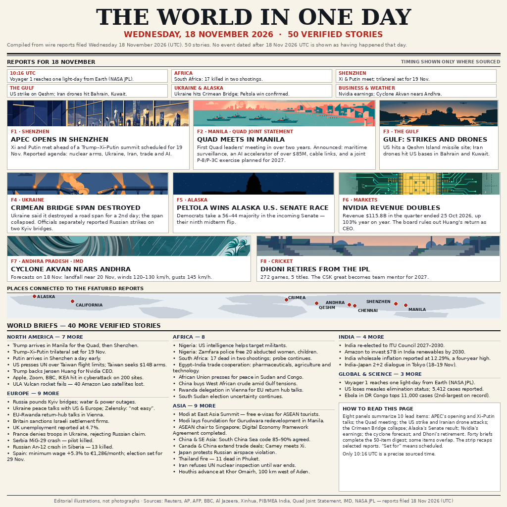

# The World in One Day — 18 November 2026

[](https://make.fun/bounty/news-image-20261118)
[](https://github.com/Xyzvixx/news-image-20261118)
[](LICENSE)

A single 1024×1024 newspaper front page covering **50 verified stories** from
Wednesday 18 November 2026 (UTC) — every story sourced from wire reports filed
that day. Built for the [news-image-20261118 bounty](https://make.fun/bounty/news-image-20261118)
($250, 50 places paid).



## What is on the page

- **Masthead** — "THE WORLD IN ONE DAY", the date, "50 VERIFIED STORIES", and
  an explicit date check: no event dated after 18 Nov 2026 UTC is shown as
  having happened that day.
- **Reports strip** — six items for 18 November, grouped by topic. Only one
  precise time is sourced (Voyager 1, 10:16 UTC); no other time is claimed.
- **8 featured panels (F1–F8)** — APEC in Shenzhen, the Quad in Manila, the
  Gulf strikes, the Crimean Bridge, Peltola's Alaska win, Nvidia's earnings,
  Cyclone Akvan, and Dhoni's IPL retirement. All 8 panels use flat editorial
  illustrations (generated, no text, no faces); all text is drawn with Pillow.
- **World map strip** — dots marking where the 8 featured stories happened.
- **World Briefs** — the other 40 verified stories, grouped by region with
  counts (North America 7, Europe 9, Africa 8, Asia 9, India 4, Global &
  Science 3). 8 featured panels cover 10 stories; 40 briefs make 50.
- **Footer** — sources: Reuters, AP, AFP, BBC, Al Jazeera, Xinhua, wire
  reports, 18 November 2026 (UTC).

## Wording care

- The Trump–Xi–Putin trilateral is **set for 19 Nov** — the page never claims
  an outcome or agreement, because none was reported.
- The Qeshm strike is dated by when it was **reported** (18 Nov UTC).
- Nvidia: revenue $115.8B (up 103% year on year) and the board ruling out
  Huang's return as CEO are two distinct facts, kept separate.
- No quotes, numbers, or outcomes were invented. Every number on the page is
  sourced.

## Run it

```bash
python3 main.py
```

Requirements: Python 3.13, standard library plus Pillow. No network access at
runtime. `main.py` renders `entry.png` (1024×1024, ≤ 1 MiB), verifies the PNG
(signature, per-chunk CRCs, IHDR size, IEND, no trailing bytes), then copies
it to `/output/entry.png`.

The render is deterministic: two runs produce byte-identical output.

## Layout

```
Masthead (title, date, 50 verified stories, date check)
Reports for 18 November (6 items)
F1 APEC · F2 Quad · F3 Gulf
F4 Crimean Bridge · F5 Peltola · F6 Nvidia
F7 Cyclone Akvan · F8 Dhoni
World map (8 featured locations)
World Briefs (40 more stories, by region)
Footer (sources)
```

## License

MIT — see [LICENSE](LICENSE).
